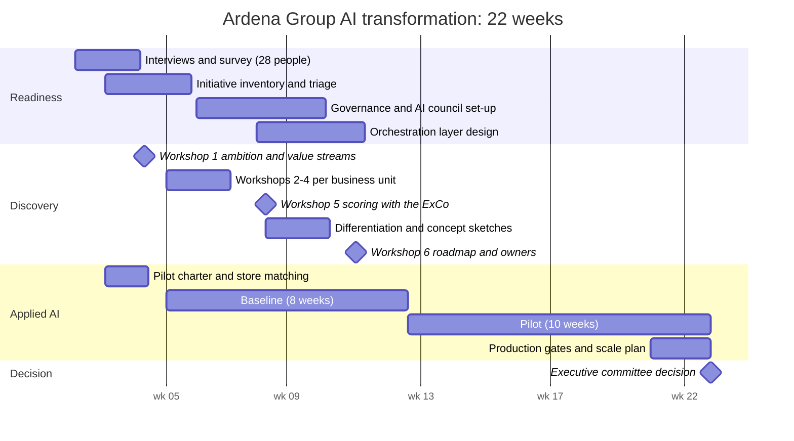

# Engagement plan (22 weeks, embedded)

The pilot charter is written in week 2 so the baseline period starts in week 4: the eight baseline weeks run while the discovery workshops happen. The ten pilot weeks run while the roadmap and the operating model are built. That is how the engagement ends with a measured pilot inside the CEO's six months, instead of a promise of one.

## Team

| Role | Who | Time |
|---|---|---|
| AI transformation lead (engagement lead, workshops, strategy, governance) | Studio | 3 days/week on site |
| Strategist / business designer (workshops, concept sketches, roadmap) | Studio | 3 days/week |
| Pilot squad: data scientist, engineer, product designer | Studio + Ardena data team | Weeks 2–18 |
| Executive sponsor | Ardena CEO | ExCo slots |
| AI council (from week 6) | CIO, CFO, COO stores, HR director, DPO, CISO | Bi-weekly |
| Business owners per use case | Ardena | Workshops 2–6 |

## Rhythm

| When | What | With |
|---|---|---|
| Monday | Pilot stand-up, weekly KPI check | Pilot squad, head of fresh |
| Wednesday (bi-weekly) | AI council: intake decisions, triage follow-up | Council |
| Thursday | Office hours for business units with AI ideas or questions | Anyone |
| Monthly | Executive committee update: one page, decisions asked | ExCo |

## Risks to the engagement

| Risk | Mitigation |
|---|---|
| The pilot becomes the whole engagement | Separate tracks with their own deliverables; the pilot squad does not run workshops |
| Workshops produce a wish list | Value and feasibility scored with criteria agreed in workshop 1; robustness test on the weights |
| Governance is seen as a brake | Start with the intake that *speeds up* approvals for low-risk use, not with a policy document |
| Business units defend their pilots | Triage rules agreed with CIO and CFO before anyone sees their own result |
