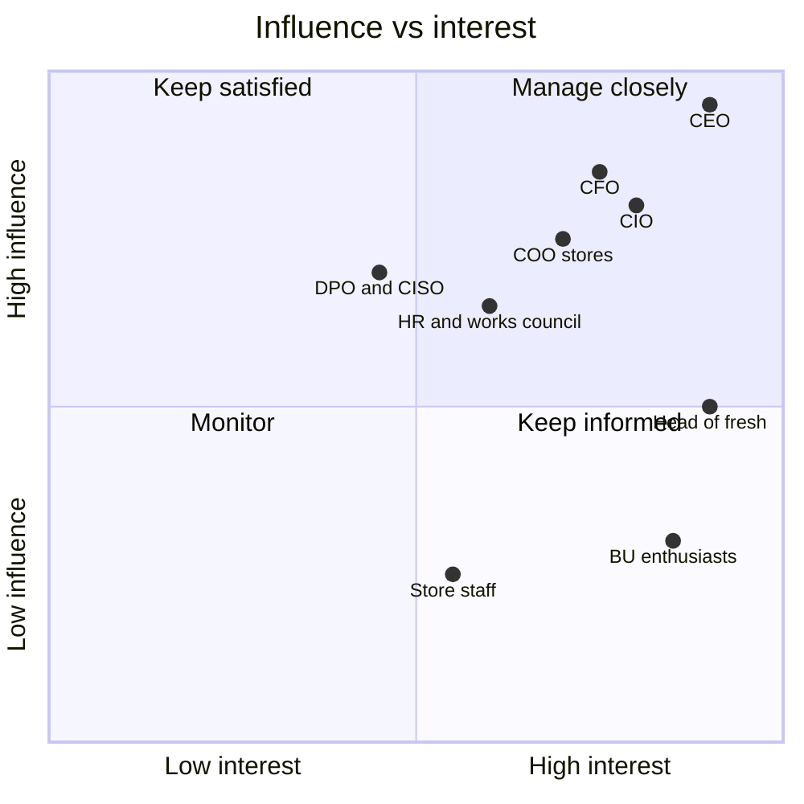

# Stakeholder map

| Stakeholder | Interest | Influence | What they need from us | Risk if ignored |
|---|---|---|---|---|
| CEO (sponsor) | Proof that AI moves the P&L; a story for the board | Very high | A clear set of bets and one result | Loses patience after 3 months of slides |
| CFO | Stop spending on things that do not pay back | High | Triage, cost per initiative, business case with haircut | Blocks the foundations budget |
| CIO | One platform instead of 30 tools; security | High | Orchestration layer design, buy-vs-build | Sees the programme as a business-led threat |
| COO stores | Store teams' time, waste, availability | High | A pilot that helps stores, not more admin | Store managers do not adopt |
| Head of fresh (pilot owner) | Waste and margin in fresh | Medium | Measured result, a say in the design | Pilot without a business owner |
| HR director and works council | Jobs, scheduling, monitoring of staff | Medium–high | Early information, clear lines (no performance scoring) | Escalation, delay |
| DPO and CISO | GDPR, AI Act, security | Medium (veto on risky use) | Register, intake, DPIA where needed | Late veto on a built system |
| Business-unit AI enthusiasts | Their pilot continues | Low–medium | A fair process and a path to scale | Shadow AI continues |
| Store staff | Simple tools that save time | Low individually, decisive collectively | Involvement in design, training | Low acceptance of suggestions |

