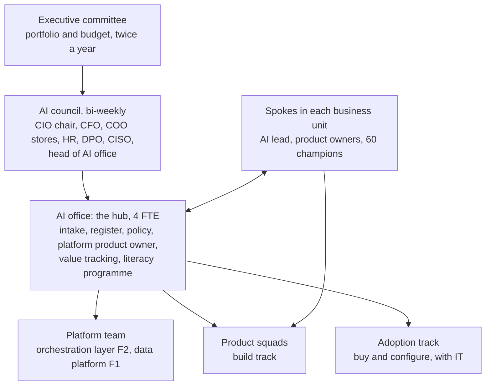
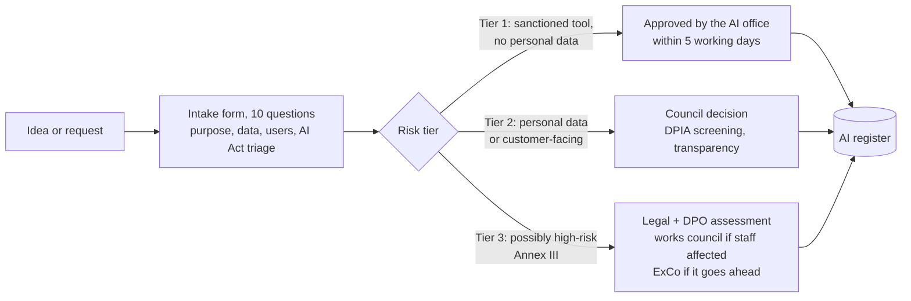

# AI operating model and governance

The goal is not control for its own sake. It is to make the *right* AI use faster and the wrong one visible. Today, a store manager who wants a sanctioned AI tool has no route at all, so the fastest route is a credit card.

## Structure: hub and spoke

| Choice | Why |
|---|---|
| Hub and spoke, not a fully central CoE | Value sits in the business units; a central team that builds everything becomes the bottleneck. The hub sets the rules and runs the platform; the spokes own the use cases. |
| Not fully federated | With governance at 1.8, letting every unit do its own thing is how Ardena got 37 initiatives. |
| CIO chairs the council, CFO sits on it | AI spend becomes visible per initiative and stoppable. |
| DPO and CISO are members, not reviewers at the end | Risk questions are answered at intake, not after the build. |

## Intake: three lanes by risk

The fast lane is the point. If Tier 1 takes five weeks, shadow AI comes back.

## RACI for the main decisions

| Decision | ExCo | AI council | AI office | BU owner | DPO / CISO | Works council |
|---|---|---|---|---|---|---|
| Portfolio and budget | **A** | R | C | C | I | I |
| Approve a Tier 1 use | I | I | **A/R** | C | I | — |
| Approve a Tier 2 use | I | **A** | R | C | C | I |
| Approve a Tier 3 use | **A** | R | R | C | C | C |
| Stop an initiative | I | **A** | R | C | I | — |
| Choose a model or vendor for the platform | I | **A** | R | C | C | — |
| Go-live of a use case | I | C | C | **A/R** | C | I |

(A = accountable, exactly one per decision; R = responsible; C = consulted; I = informed.)

## Policy and principles

- [AI policy](ai-policy.md): one page for every employee
- [Human-first principles](human-first-principles.md): what Ardena will and will not do with AI towards staff and customers
- [AI Act register](ai-act-register.md) and [ISO/IEC 27001 and 42001 alignment](iso-27001-and-42001.md)
- The [orchestration layer](orchestration-layer.md) is how the policy becomes the easy path rather than a document.
