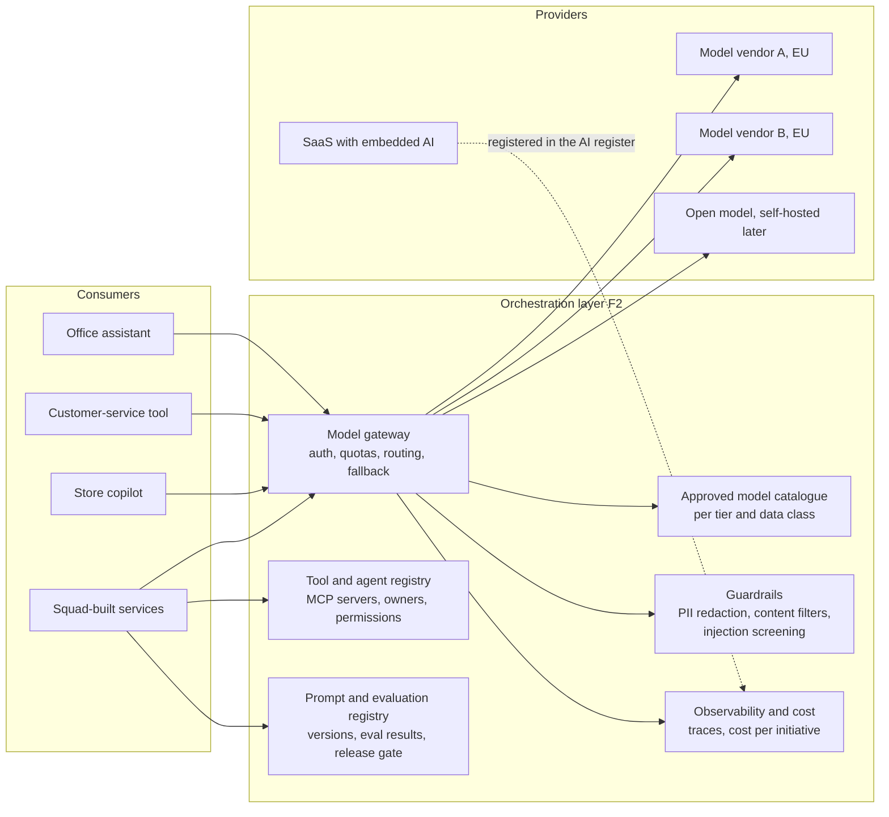

# AI orchestration layer

The vacancy-style phrase "bring scattered AI efforts under a clear operational framework" has a technical half. Policy alone does not stop a team from wiring a model API into a store app with a personal key. A shared layer does, if it is the easiest way to build.

## What it is

One platform that every AI use at Ardena goes through, whatever the vendor or model:

| Capability | What it solves at Ardena today |
|---|---|
| Gateway with quotas and cost per initiative | Nobody knows what AI costs; a team cannot overspend unseen |
| Approved model catalogue | Teams use whatever model they found; contracts and EU processing unchecked |
| Tool and agent registry | Agents that call internal systems are built without owners or permission review |
| Prompt and evaluation registry | Pilots cannot be compared; nobody knows if a model change broke something |
| Guardrails | Personal data pasted into prompts; no injection screening on documents |
| Observability | No traces, so no audit trail and no incident analysis |

SaaS tools with embedded AI (CRM, ATS, office suite) do not route through the gateway. They are governed through the register, procurement and vendor assessment instead. That is where I-09, the CV-screening plug-in, should have been caught.

## Buy, build or assemble

| Option | For | Against | Fit for Ardena |
|---|---|---|---|
| **Cloud-native platform** of the existing cloud provider (model hosting, gateway, evaluation and agent services) | Fast, integrated with identity and networking Ardena already has; enterprise contracts | Ties the layer to one cloud; some capabilities immature or priced per feature | **Chosen as the base** |
| **Specialised AI gateway / LLMOps product** (commercial or open source) on top | Multi-model routing, better cost and eval tooling | Another vendor or component to run | Add the gateway component if the cloud's own gateway lacks routing or cost features after the 90-day review |
| **Build our own** | Full control | A platform team Ardena does not have; maintenance forever | Rejected |
| **Do nothing; each unit picks its own** | No upfront cost | This is the current state | Rejected |

The decision rule: **assemble from the existing cloud first, add a specialised component only for a gap that blocks a use case on the roadmap**, and keep the gateway interface stable so the model behind it can change.

## Ninety days

| Month | Delivered |
|---|---|
| 1 | Gateway in front of two approved models; Copilot users and customer service routed; cost per initiative visible |
| 2 | Guardrails (PII redaction, content filtering); approved model catalogue; first prompts in the registry |
| 3 | Evaluation harness with a release gate; tool registry with the first MCP server (product data, read-only); shadow tools switched off |

Success measure: by month 4, zero shadow tools in the triage follow-up, and every new AI use visible in cost and the register.
