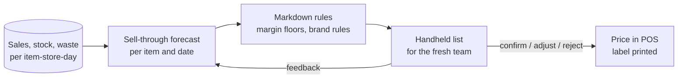

# Solution concepts for the top three use cases

One page each: the concept, who is involved, what data it needs, and what it would take. Enough for an executive decision and for a squad to start discovery; not a design.

## UC-01 Fresh markdown advisor

**Concept.** Every morning, the advisor lists fresh items in a store that will likely not sell before their date at the current price, with a suggested markdown and the expected effect. A fresh team member confirms, adjusts or rejects on a handheld; labels print at the shelf. Rejections are learning data.

| Stakeholder | Role | Concern |
|---|---|---|
| Head of fresh | Business owner | Waste down without margin loss |
| Store fresh teams | Users | Time, simplicity; not being overruled by a system |
| Commercial / pricing | Rules owner | Brand price perception; margin floors |
| IT / POS | Integration | Price changes in POS and labels |
| Works council | Informed | No individual performance monitoring |

| Data | Source | Status |
|---|---|---|
| Sales per item-store-day | POS | Available, 24 h delay |
| Stock and expiry dates | Store inventory | Partial: expiry known for 70% of fresh lines |
| Waste per item | Waste scanning | Available in 180 stores |
| Markdown history | POS | Available |
| Margin floors | Commercial | To be written down |

**Pilot result:** <!--n:pilot.effect-->0.88 pp<!--/n--> less waste, decision <!--n:pilot.decision-->GO<!--/n-->. See [pilot results](../04-applied-ai/pilot-results.md).

## UC-05 Personalised promotions in the app

**Concept.** Weekly offers per customer from loyalty data, constrained by what is in stock and fresh in the customer's store. A test-and-learn engine with holdout groups measures incremental margin, not clicks.

| Stakeholder | Role | Concern |
|---|---|---|
| CMO | Business owner | Incremental margin per active customer |
| Category managers | Supplier funding | Fair visibility for brands |
| DPO | Consent and profiling | GDPR basis for profiling; transparency (AI Act Art. 50 where content is generated) |
| E-commerce | App | Performance, user experience |

| Data | Source | Status |
|---|---|---|
| Loyalty transactions | Loyalty platform | Available, 2.1m active cards |
| Consent and preferences | CRM | Available; consent rate 64% for personalisation |
| Store stock and freshness | F1 | Needs the data platform |
| Promotion history and supplier funding | Commercial | Partly in spreadsheets |

**Why not now:** needs F1 for stock-aware offers; without it, this is the same generic personalisation Grenvale already does.

## UC-02 Store-level automated ordering

**Concept.** A store-level demand forecast drives replenishment orders, with store managers reviewing exceptions instead of placing every order. Start with fresh in 40 stores, then ambient.

| Stakeholder | Role | Concern |
|---|---|---|
| Director supply planning | Business owner | Availability and stock days |
| Store managers | Users and approvers | Losing control; trust in the forecast |
| DCs | Downstream | Order volatility |
| Suppliers | Downstream | Forecast sharing |

| Data | Source | Status |
|---|---|---|
| Sales and stock per item-store-day | F1 | Needs the data platform |
| Product master (pack sizes, lead times) | F4 | 61% complete; needs master-data quality |
| Promotions and events | Commercial | Needs the promo calendar in a system |
| Forecast model | I-31 trial | Forecast error −9% in 20 stores; not connected to ordering |

**Why it is a bet and not a quick win:** nine months of work, two foundations (F1, F4), and the change for store managers is large. It is also where Volta Markt is heading, so not doing it is not an option for long.
