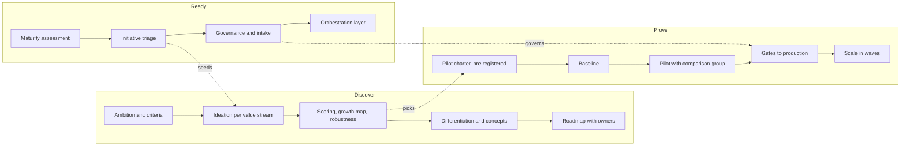

# AI transformation playbook

The method behind this case, written to be reused for the next client. Three tracks run in parallel from week 1, because each one needs the others: discovery without readiness produces a wish list; readiness without a pilot produces a policy nobody reads; a pilot without discovery solves the wrong problem.

## Principles

1. **Start from the work, not from AI.** Ideation begins with a process people know and its pains.
2. **Decide the criteria before the candidates.** Weights agreed in workshop 1, robustness shown in workshop 5.
3. **Separate commodity from differentiation.** Buy the first cheaply; build the second deliberately.
4. **Every initiative leaves with a decision and a reason.** Scale, fix, merge, pause, stop.
5. **Governance is a fast lane, not a gate.** Low-risk requests answered in days.
6. **Pre-register success.** Write the criteria before the data; use a comparison group.
7. **Production is a set of gates, not a date.** Data feed, monitoring, support, ownership, budget.
8. **Leave the client able to do it without you.** Toolkit, playbook and a trained AI office.

## Timing (typical, 20–24 weeks embedded)

| Weeks | Ready | Discover | Prove |
|---|---|---|---|
| 1–4 | Interviews, survey, inventory | Workshop 1 | Pilot charter, baseline starts |
| 5–8 | Triage, council set-up | Workshops 2–5 | Baseline |
| 9–14 | Intake live, orchestration design | Differentiation, concepts, workshop 6 | Pilot running |
| 15–22 | Platform first release | Roadmap approved | Pilot evaluated, gates, scale plan |

## Variants

- **Smaller organisation (250 people):** one track lead, three workshops, readiness as interviews only; see the sister case *enterprise-ai-transformation*.
- **Public sector:** see [public-sector variant](public-sector-variant.md).
